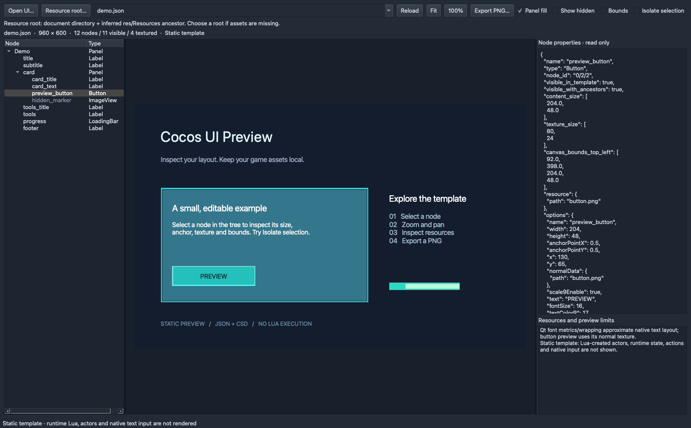
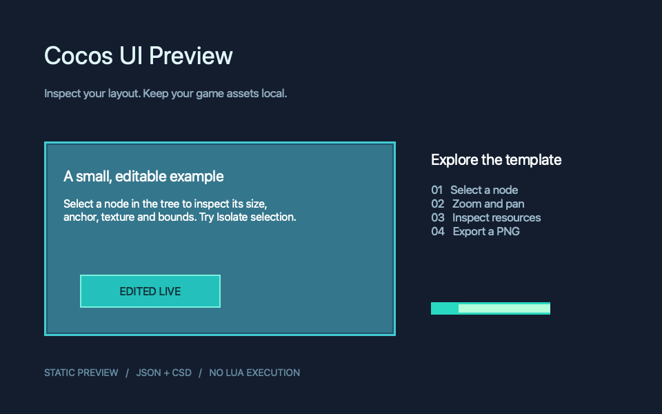

# Cocos UI Preview

An offline desktop inspector and legacy JSON property editor for Cocos2d-x /
Cocos Studio UI files. Edit typed fields, preview changes, undo/redo and save
without starting your game. Studio ObjectData JSON and CSD remain view-only.



*Actual macOS app capture using the bundled original demo. The node tree,
canvas and typed property editor are shown together after editing and reopening.*

**Early release: static property editor, not a Cocos runtime or full scene editor.**

## Install

The macOS app and ZIP have been built and validated locally. A public binary
release has not been uploaded yet; build from source below, or check
[Releases](https://github.com/minhnndev/cocos-ui-preview/releases) for future uploads.
For a ZIP build, extract it and drag **Cocos UI Preview.app** to Applications. Python is bundled.
The initial build is Apple Silicon (arm64), locally validated on macOS 26;
its declared minimum is macOS 12, which has not been independently tested.
The app is ad-hoc signed, not Developer ID signed or notarized. For a download
blocked by macOS, review the source/build identity and use the standard
Privacy & Security > Open Anyway flow. Do not disable Gatekeeper globally.

For source use on macOS, Linux or Windows (Python 3.10+):

```sh
pip install .
cocos-ui-preview
cocos-ui-preview path/to/screen.csd --resource-root path/to/Resources
```

The CI workflow is configured for Linux/Windows/macOS source checks. Only local
macOS runs are validated for this release; see Actions for actual CI results.
Binary releases and interactive platform acceptance currently cover macOS only.

## Use

- Open UI: legacy `widgetTree` JSON, Studio 2/3 `ObjectData` JSON, or `.csd` XML.
- Resource root: choose your project's `res`/`Resources` root if relative paths need it.
- Select a node on the canvas or tree. Edit properties has Transform, Content,
  Appearance and Resources tabs; Computed / raw shows read-only geometry/data.
- Numeric fields support typing and ± arrows; opacity/progress also have sliders.
  Booleans use checkboxes, modes use dropdowns, and colors use a color picker.
  Text updates live; line inputs commit on Enter or leaving the field.
- Preview updates retain zoom, selection, expanded branches and isolation.
- Undo/Redo (Cmd/Ctrl+Z, Shift+Cmd/Ctrl+Z) retain up to 500 commands; rapid edits
  to the same numeric/text field are grouped. The ↺ button restores a field to
  its last loaded/saved value and can itself be undone.
- Save (Cmd/Ctrl+S) writes legacy JSON atomically. Save As requires a **new name
  in the same source folder**, preserving relative texture/font/plist references.
  To relocate a project, copy its resource folder together with the template.
- The default demo is a writable copy in your user application-data folder;
  the bundled original is never overwritten by the default launch.
- Unsaved changes prompt on Open/Reload/drop/close. External source changes
  block Save; use a new filename or review your changes before reloading.
- Scroll to zoom, drag empty canvas to pan, Fit to reset the view.
- Show hidden reveals template states; Bounds draws geometry; Isolate selection
  draws only the selected subtree while retaining ancestor transforms/clipping.
- Reload picks up source changes. Export PNG saves the current static canvas.
- Finder Open With and dropping a JSON/CSD file open it in the macOS app.

```sh
cocos-ui-preview screen.json --resource-root Resources \
  --export preview.png --report preview.json
```

The report lists missing/ambiguous resources and preview limits. It contains
local paths; review it before sharing. The bundled demo and icon are original,
redistributable fixtures. No game data is included.

<details>
<summary>Preview the exported demo PNG</summary>



*The same demo exported as a PNG, without the editor panels or selection bounds.*

</details>

## Support boundary

Supported common widgets: Panel, ImageView, Button (normal texture), LoadingBar,
Label, LabelBMFont (text FNT), TextField placeholder, Sprite, Node, and
ScrollView/ListView/PageView containers. Supports hierarchy, anchor/scale/rotation,
authored positions, legacy percent size/position, visibility, clipping, scale9,
tint, flip, progress crop, local textures, and plist formats 1/2/3 (trim/rotation/alias).

CSD/Studio JSON normalizes common properties only. Layout constraints, percent
reflow, nested ProjectNode, advanced widget state, timeline, rich-text effects,
and independent skew are not simulated. Scroll/list/page containers show authored
positions without scrolling or reflow. Unknown widgets are reported as containers.

Editing currently covers common scalar properties, text, RGB colors, panel fill,
normal textures/fonts/atlas references and scale9. Unsupported values stay
read-only. Inactive size/position fields explain which mode controls them.
Negative scales and anchors outside 0–1 are supported. Renaming a node can affect
Lua lookups. Computed bounds/texture sizes and preview visibility toggles are not
written as authored properties. Unknown legacy JSON members are preserved
semantically; whitespace can be reformatted (indentation, BOM and newline style
are retained where detected). Duplicate keys/nonstandard numbers are view-only.
Studio JSON/CSD Save, node creation/deletion/reparenting, drag/resize handles,
multi-selection, animation editing and CSB are not implemented.

No CSB decoder, Lua/JS execution, Cocos Creator scene/prefab format, native input,
actors, animation, game state, or native visual equivalence. Qt font metrics and
wrapping can differ from Cocos. Always verify final text fit and runtime UI in game.
Do not open untrusted assets as a security sandbox: image/font libraries still
parse local files and documents can reference absolute paths.

## Develop and build

```sh
uv sync --group build --python 3.12
uv run python -m unittest discover -s tests -v
uv run cocos-ui-preview
uv run python scripts/build_macos.py --output artifacts
```

Build output: `artifacts/Cocos UI Preview.app`, ZIP, source archive, and SHA256SUMS.
Build uses only this repository and locked packages; it never packages an input
project. `Contents/Resources/legal/` carries source, lockfile, and dependency notices.

Smoke the built executable (including its real window, tree selection and export):

```sh
"artifacts/Cocos UI Preview.app/Contents/MacOS/Cocos UI Preview" --smoke-test artifacts/smoke
```

This repository is maintained independently of any game checkout. Game projects
open as external input; they do not need a tool source mirror, launcher or Python
environment inside their own source tree. Use the app's Open UI / Resource root,
or run `cocos-ui-preview /path/to/game/res/studio_ui/screen.json --resource-root /path/to/game/res`.

Optional integration checks can use a local project with `NewPlayerLayer.json`
and `ToolKitLayer.json` fixtures. They edit temporary copies and never save over
the project's templates. No game assets are included in this repository:

```sh
COCOS_UI_PREVIEW_GAME_ROOT=/path/to/game \
  uv run python tests/integration/test_game_project.py -v
```

Without that environment variable, the two game-specific checks are skipped;
the synthetic checks still run. Standalone tests above require no game checkout.

CI tests source on Linux/Windows/macOS and builds macOS artifacts. Public release
publishing is a manual maintainer step after inspection; CI does not upload a
release automatically. See [THIRD_PARTY](THIRD_PARTY.md) for license/source details.

## License

GPL-3.0-only. See [LICENSE](LICENSE), [NOTICE](NOTICE), and [THIRD_PARTY](THIRD_PARTY.md).
Inspired by WangChuan5ef's MIT Cocos UI Visualizer; implemented as an independent
viewer. Not affiliated with Cocos or any game publisher.
